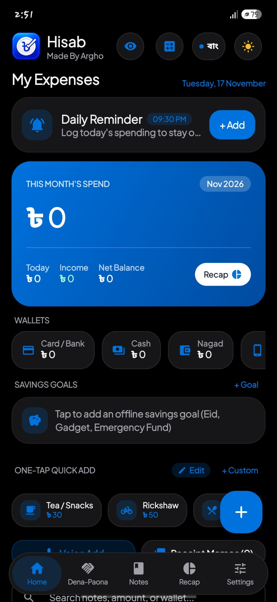
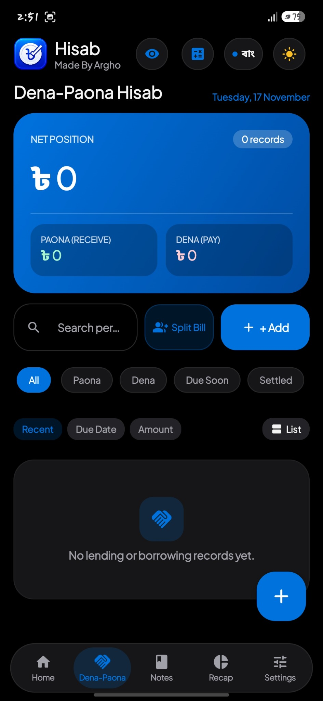
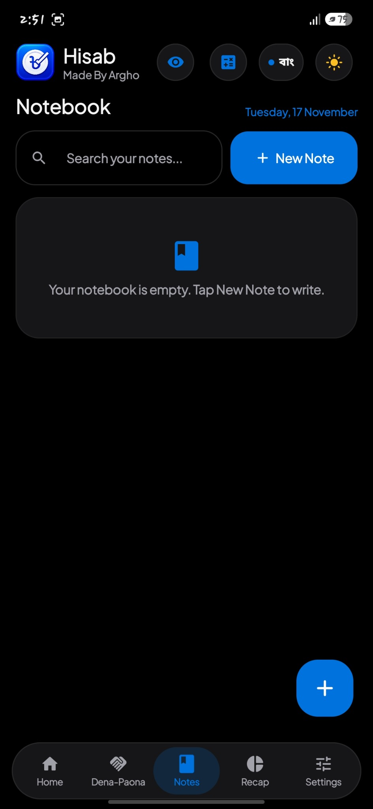
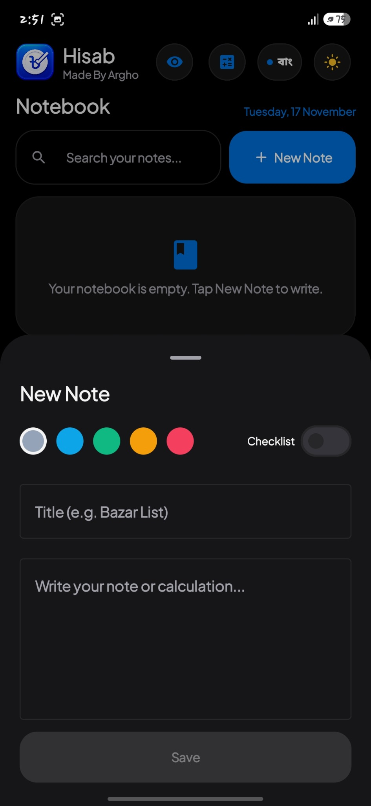

[README.md](https://github.com/user-attachments/files/34961984/README.md)

# Hisab

### Your personal finances, organized.

**A simple, offline-first Android finance manager for tracking everyday spending, managing dues, keeping notes, and staying on top of your budget.**

 

 

 

**Designed and developed by [Alindo Dhar](https://github.com/alindodhar)**

[Download APK](https://github.com/alindodhar/Hisab-App/releases/latest) · [Report an issue](https://github.com/alindodhar/Hisab-App/issues)

---

## About Hisab

**Hisab** is a lightweight personal finance manager built to make everyday money management easier. It brings expense tracking, wallets, budgets, personal notes, and a due-and-receivable ledger together in one clean interface.

The app is designed around an **offline-first, local-storage approach**. You can organize your records on your device and use the available export and backup options to keep a copy of your information.

## Screenshots

Take a look around Hisab.

| Home dashboard | Dena-Paona ledger |
|:---:|:---:|
|  |  |
| **Spend recap** | **Notebook** |
|  |  |
| **Budget and wallets** | **Settings and security** |
|  |  |
| **Reminders and backup** | **Create a note** |
|  |  |

More screenshots

 

## Features

### 💸 Expense tracking
- Keep track of everyday spending.
- View this month's spending, today's spending, income, and net balance.
- Use quick-add templates for frequent transactions.
- Organize transactions with categories.

### 👛 Wallets
- Keep separate balances for Card/Bank, Cash, Nagad, and bKash.
- Set opening balances for your wallets.
- Review spending by payment source.

### 🤝 Dena-Paona ledger
- Record money you owe and money others owe you.
- View your net position, total receivables, and total payables.
- Search, filter, and sort ledger records.
- Use Split Bill to organize shared expenses.

### 📊 Spend recap
- Review spending across weekly, monthly, multi-period, or custom views.
- See daily averages, top categories, and highest spending.
- Explore category and payment-source breakdowns.

### 📝 Personal notebook
- Create and search personal notes.
- Choose note colours.
- Create checklist-style notes.

### 🎯 Budget and savings
- Set a monthly budget limit.
- Configure category budgets and custom categories.
- Create savings goals for things that matter to you.

### 🔔 Reminders and payment alerts
- Set a daily reminder with vibration.
- Test reminder alerts from Settings.
- Optional Payment Alert Quick-Capture can detect supported bKash, Nagad, and bank payment notifications locally when notification access is enabled.

### 🔐 Privacy and protection
- Local storage for your finance records.
- Optional app lock with a 4-digit PIN and/or device biometric authentication.
- Export statements and create backups for your own safekeeping.

### 📦 Export and backup
- Export a PDF statement.
- Export data as Excel-compatible CSV.
- Create a backup and restore it later using the in-app controls.

## Download and installation

**Latest release: v1.0.0**

1. Open the [Hisab Releases page](https://github.com/alindodhar/Hisab-App/releases/latest).
2. Download the APK attached to the latest release.
3. Open the downloaded APK on your Android device.
4. If Android asks for permission to install an app from that source, review the prompt and allow it only if you trust the file.
5. Complete the installation and open Hisab.

> Only download APK files from the official repository or another source you trust. Android may display a security warning for apps installed outside Google Play.

## Permissions

Hisab may request access to certain Android features to provide optional functionality:

| Permission / access | Why it may be needed |
|---|---|
| Notifications | To show reminders and app alerts. |
| Notification access (optional) | To detect supported payment notifications for Payment Alert Quick-Capture. |
| Biometric authentication (optional) | To let Android authenticate you before unlocking the protected app area. |

You can choose whether to enable optional features. Android permission names and prompts may vary by device and OS version.

## Privacy

Hisab is designed for local, offline personal finance management. The app's core purpose is to keep your finance records on your device rather than require an online account.

- **No account is described as necessary** for the app's core local features.
- **Local records:** expenses, wallets, ledger entries, notes, budgets, and related app data are intended to be stored locally on your device.
- **Payment notifications:** if you enable Notification Access and Payment Alert Quick-Capture, the app may read notifications from supported payment apps to identify transaction details. This access should be used only for the stated feature.
- **Backups and exports:** when you create a backup or export a statement, you choose where to save or share that file. Keep exported files secure.
- **Biometrics:** biometric verification is handled through Android's device authentication system; the app should not receive your fingerprint or face biometric data.
- **Uninstalling:** uninstalling the app or clearing its storage may remove locally stored records. Export or back up important information first.

Read the full [Privacy Policy](PRIVACY_POLICY.md).

> **Developer note — please verify before publishing:** This policy is drafted from the features and screenshots supplied for this repository. Before publishing, check the app's actual source code, manifest, dependencies, and build configuration. In particular, confirm whether any analytics, crash reporting, advertising SDKs, network requests, cloud sync, or third-party services collect data. Update this policy if the implementation differs.

## Project information

| Item | Details |
|---|---|
| App name | Hisab |
| Description | Personal Finance Manager |
| Platform | Android |
| Developer | Alindo Dhar |
| Current version | 1.0.0 |
| Package format | APK |
| Distribution | GitHub Releases |
| Storage approach | Local / offline-first, as described by the project |

## Feedback and support

Found a bug or have an idea to improve Hisab?

- [Open an issue](https://github.com/alindodhar/Hisab-App/issues)
- [Browse releases](https://github.com/alindodhar/Hisab-App/releases)

When reporting a problem, include your Android version, device model, app version, and steps to reproduce the issue. **Do not attach screenshots or exports containing private financial information.**

## Developer

**Alindo Dhar**

GitHub: [@alindodhar](https://github.com/alindodhar)

## License

No open-source license has been specified for this project. Unless a license is added to the repository, all rights are reserved by the developer. You may not assume permission to reuse, modify, or redistribute the source code or app.

---

**Hisab — Manage Your Money, Simply.**

Made with care by **Alindo Dhar**.

