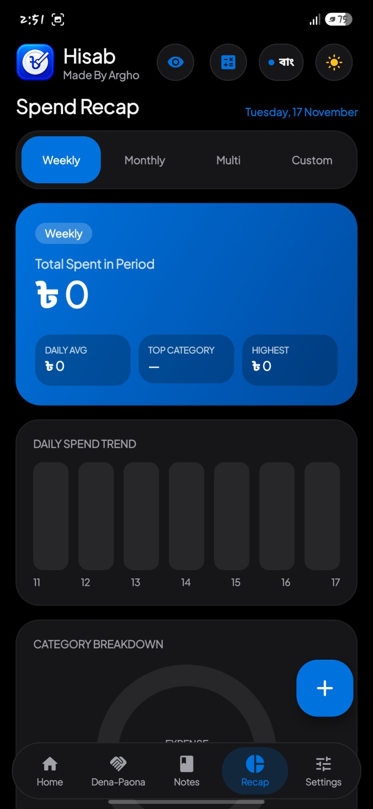
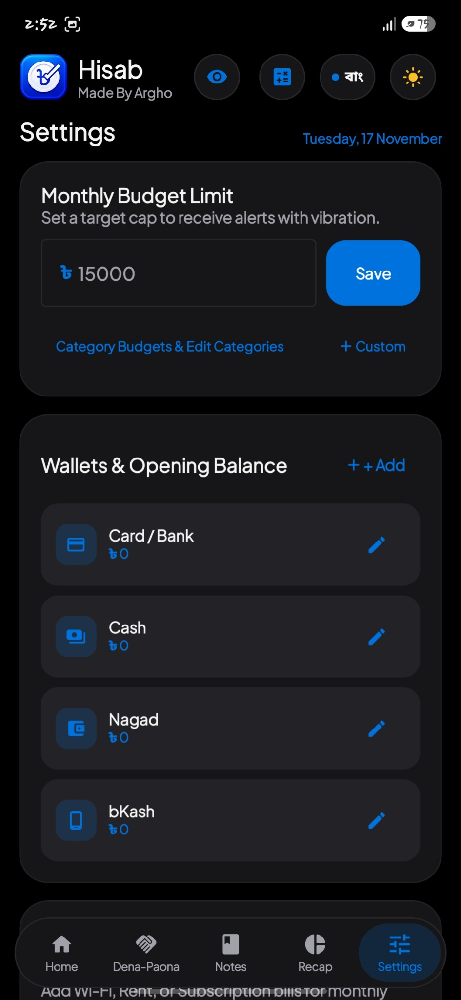
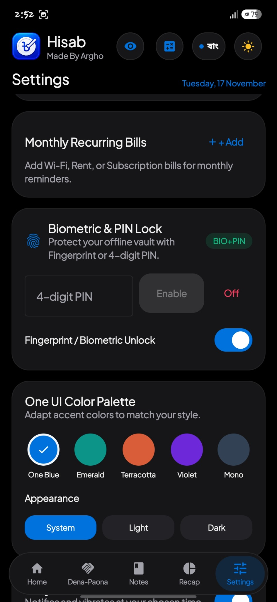
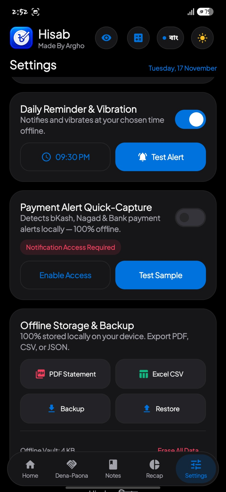
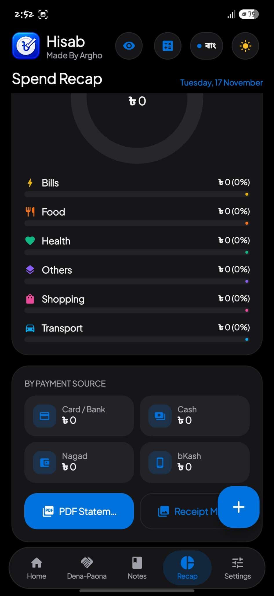

[README.md](https://github.com/user-attachments/files/34964977/README.md)

# Hisab

### Your personal finances, organized.

A simple, offline-first Android finance manager for tracking everyday spending, managing dues, keeping notes, and staying on top of your budget.

 

 

 

**Designed and developed by [Alindo Dhar](https://github.com/alindodhar)**

[Download APK](https://github.com/alindodhar/Hisab-App/releases/latest) · [Report an issue](https://github.com/alindodhar/Hisab-App/issues)

---

## Overview

**Hisab** brings everyday money management into one clean, easy-to-use place. Track expenses, manage wallets and budgets, keep personal notes, and stay on top of money you owe or are owed.

Built with an **offline-first, local-storage approach**, Hisab is designed to help you manage your finances directly on your device.

## At a glance

| | |
|:--|:--|
| **Platform** | Android |
| **App version** | 1.0.0 |
| **Storage** | Local / offline-first |
| **Package format** | APK |
| **Distribution** | GitHub Releases |
| **Developer** | [Alindo Dhar](https://github.com/alindodhar) |

## Screenshots

A quick look at the Hisab interface.

| Home dashboard | Dena-Paona ledger |
|:---:|:---:|
|  |  |

| Spend recap | Personal notebook |
|:---:|:---:|
|  |  |

| Budgets and wallets | Settings and security |
|:---:|:---:|
|  |  |

| Reminders and storage | Create a note |
|:---:|:---:|
|  |  |

<strong>View more screenshots</strong>

 

## Features

### Expense tracking
- Record everyday spending and income.
- Review today's and this month's activity.
- Use quick-add templates for frequent transactions.
- Organize transactions with categories.

### Wallets
- Manage separate balances for Card/Bank, Cash, Nagad, and bKash.
- Set opening balances.
- Review spending by payment source.

### Dena-Paona ledger
- Track money you owe and money others owe you.
- View total receivables, payables, and your net position.
- Search, filter, and sort ledger records.
- Organize shared expenses with Split Bill.

### Spend recap
- Review weekly, monthly, multi-period, or custom date ranges.
- See daily averages, top categories, and highest spending.
- Explore category and payment-source breakdowns.

### Personal notebook
- Create and search personal notes.
- Choose note colours.
- Make checklist-style notes.

### Budget and savings
- Set a monthly budget.
- Configure category budgets and custom categories.
- Create savings goals.

### Reminders and payment alerts
- Set daily reminders with vibration.
- Test reminder alerts from Settings.
- Optionally use Payment Alert Quick-Capture for supported bKash, Nagad, and bank notifications when Notification Access is enabled.

### Privacy and protection
- Keep finance records in local app storage.
- Protect the app with an optional 4-digit PIN and/or device biometric authentication.
- Export statements and create backups.

### Export and backup
- Export PDF statements.
- Export data as Excel-compatible CSV.
- Create backups and restore them later using the in-app controls.

## Download and installation

**Latest release: v1.0.0**

1. Open the [Hisab Releases page](https://github.com/alindodhar/Hisab-App/releases/latest).
2. Download the APK attached to the latest release.
3. Open the downloaded APK on your Android device.
4. If Android asks for permission to install from that source, review the prompt and allow it only if you trust the file.
5. Finish installation and open Hisab.

> **Safety note:** Download APK files only from the official repository or another source you trust. Android may show a security warning for apps installed outside Google Play.

## Permissions

Hisab may request access to Android features for optional functionality.

| Permission / access | Purpose |
|:--|:--|
| Notifications | Show reminders and app alerts. |
| Notification Access *(optional)* | Detect supported payment notifications for Payment Alert Quick-Capture. |
| Biometric authentication *(optional)* | Let Android authenticate you before unlocking the protected app area. |

Optional features can be enabled or left disabled. Permission names and prompts may vary by Android version and device.

## Privacy

Hisab is designed for local, offline personal finance management. Its core purpose is to keep your finance records on your device rather than require an online account.

- **Local records:** Expenses, wallets, ledger entries, notes, budgets, and related app data are intended to be stored locally.
- **No required account:** An online account is not described as necessary for the app's core local features.
- **Payment notifications:** If you enable Notification Access and Payment Alert Quick-Capture, the app may read notifications from supported payment apps to identify transaction details.
- **Backups and exports:** You choose where to save or share exported files. Keep those files secure.
- **Biometrics:** Verification is handled through Android's device authentication system; the app should not receive your fingerprint or face biometric data.
- **Uninstalling:** Uninstalling the app or clearing its storage may remove locally stored records. Back up important information first.

Read the full [Privacy Policy](PRIVACY_POLICY.md).

> **Developer checklist before publishing:** This README and the privacy policy are based on the feature information supplied for the repository. Verify the actual source code, manifest, dependencies, and build configuration. In particular, confirm whether analytics, crash reporting, advertising SDKs, network requests, cloud sync, or third-party services collect data. Update the policy if the implementation differs.

## Support

Found a bug or have an idea to improve Hisab?

- [Open an issue](https://github.com/alindodhar/Hisab-App/issues)
- [Browse releases](https://github.com/alindodhar/Hisab-App/releases)

When reporting a problem, include your Android version, device model, app version, and steps to reproduce it.

**Please do not attach screenshots or exported files containing private financial information.**

## Developer

**Alindo Dhar**

GitHub: [@alindodhar](https://github.com/alindodhar)

## License

No open-source license has been specified for this project. Unless a license is added to the repository, all rights are reserved by the developer. You may not assume permission to reuse, modify, or redistribute the source code or app.

---

**Hisab — Manage Your Money, Simply.**

Made with care by **Alindo Dhar**.

